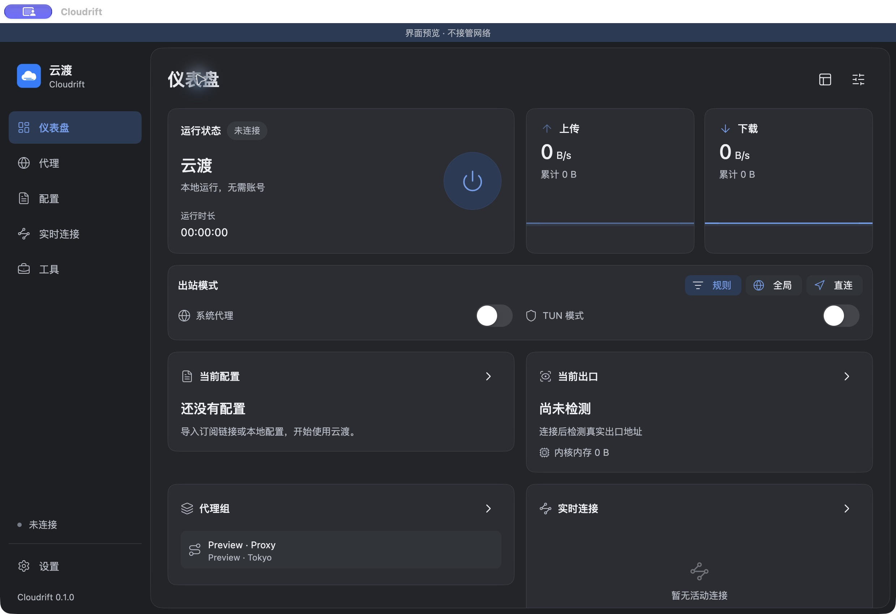

# dclash

dclash 是一款使用 Flutter 构建的跨平台代理客户端，采用 GetX 管理应用状态，提供简洁的配置管理、代理控制和网络运行状态面板。

项目面向需要在 Android 和桌面设备上管理代理配置的用户，支持订阅链接、本地 YAML 配置和自定义配置，并提供系统代理、TUN、代理组、连接记录和流量统计等功能。



## 功能特性

- 配置管理：导入订阅链接、本地文件、剪贴板内容或自定义 YAML。
- 配置维护：切换、刷新、自动更新、编辑、复制、导出和删除配置。
- 代理控制：启动和停止代理核心，支持规则、全局、直连三种出站模式。
- 网络接管：支持系统代理和 TUN 模式，并提供局域网、IPv6、绕过域名等选项。
- 代理组：查看代理组和节点，搜索、排序、测速并切换当前节点。
- 运行监控：实时显示上传、下载、累计流量、内存、运行时长和当前连接。
- 流量统计：在“工具 → 流量统计”查看按应用、域名和节点的流量排行、上传/下载排序与每日用量；支持今日、近 7 天、近 30 天和按日期查看，默认保留最近 30 天。工具页还提供节点质量趋势、DNS 观察台与按应用/域名/节点聚合的连接治理。
- 诊断工具：一键网络诊断（核心、代理监听、系统代理、系统 DNS、直连和分流对比）、规则命中与分流解释（本地规则匹配，不发请求）、本地报告历史、网址诊断与线路对比、服务可用性检测、网络状态时间线、可复制/导出的脱敏诊断报告包、出口 IP 检测、请求历史、DNS 查询和运行日志。
- 资源库：管理可复用的代理、规则集、正则过滤器和图标集，并在配置编辑器中引用。
- 共享脚本：集中维护配置脚本，也可在单个配置中固定脚本选择和执行顺序。
- 标准扩展：每个配置可维护附加规则和 MATCH 目标，并提供局域网、本机直连等常用预设。
- 配置编辑：支持 YAML 编辑器和结构化配置编辑器，保留未覆盖的原始字段。
- 数据管理：支持本地备份、恢复和 WebDAV 备份。
- 桌面体验：沉浸式标题栏、系统托盘、开机启动、深浅主题和 macOS DMG 打包。
- 多语言与主题：支持简体中文、English、浅色、深色、纯黑和多种主题色。

## 设置菜单

桌面和手机使用相同的菜单分组，桌面专用功能仅在桌面显示：

| 分组 | 功能 |
| --- | --- |
| 通用 | 外观、启动与窗口、首页与显示、桌面快捷键、通知 |
| 连接 | 代理设置、DNS 与 TUN、高级配置；Android 另有分应用代理 |
| 系统 | 内核与服务、备份与恢复、数据与隐私、性能与节能 |
| 关于 | 关于、三方许可、更新检查 |

启动与窗口支持打开应用时自动连接、开机启动、启动时隐藏、关闭到托盘和记住窗口大小；首页与显示可调整卡片顺序、显隐并恢复默认布局。内核与服务提供配置重载、重启和平台对应的维护操作，操作失败会在界面显示原因。

数据与隐私可分别关闭流量、时间线、节点质量和诊断历史记录，设置 7 / 14 / 30 / 90 天保留时间，并单独清理历史及内存中的日志、DNS 展示记录。关闭记录保留已有历史；缩短保留时间会删除超期数据，各类历史仍有条数上限。

桌面全局快捷键、系统通知和自动检查更新默认关闭。订阅更新失败默认在应用内提醒，同一订阅 30 分钟内最多提醒一次；启用系统通知后同时发送桌面提醒。更新检查访问本项目 GitHub 正式发布接口，下载和安装由用户手动完成。性能与节能支持前台 1 / 2 / 5 秒、后台 5 / 10 / 30 秒刷新，默认前台 1 秒、后台 5 秒。

## 支持平台

| 平台 | 状态 |
| --- | --- |
| Android | 支持核心运行、VPN 服务和分应用代理配置 |
| macOS | 支持桌面运行、系统代理、TUN、托盘和 DMG 打包 |
| Windows | 提供桌面构建目标，系统权限和网络接管需在目标设备验证 |
| Linux | 提供桌面构建目标，系统权限和网络接管需在目标设备验证 |
| iOS | 暂未提供运行时支持 |

## 快速开始

### 环境要求

- Flutter 3.44 或更高版本
- Dart 3.12 或更高版本
- Go 1.27 或更高版本
- Rust 1.99 或更高版本
- macOS 构建需要 Xcode；Android 构建需要 Android SDK 和 NDK
- Linux 构建需要插件开发库；Debian / Ubuntu 可安装 `libnotify-dev` 和 `libkeybinder-3.0-dev`，分别供系统通知和全局快捷键使用

首次构建会下载 Flutter、Go、Rust 和平台插件所需的依赖。

### 获取依赖并启动

```sh
flutter pub get
make dev
```

`make dev` 会根据当前操作系统启动桌面调试版本。也可以直接指定 Flutter 设备：

```sh
make run DEVICE=macos
make run DEVICE=emulator-5554
```

首次使用时，在“配置”页面导入订阅链接或 YAML 文件，选择配置后即可从仪表盘启动代理核心。

### 只读预览

预览模式使用临时配置目录和内存设置，不启动代理核心，也不会修改系统网络：

```sh
make preview
```

## 常用命令

```sh
make get             # 安装依赖
make dev             # 启动当前宿主的桌面调试版
make preview         # 启动只读界面预览
make analyze         # 运行 Dart 静态分析
make test            # 运行单元测试和界面测试
make check           # 格式化、分析和测试
make apk-debug       # 构建 Android ARM64 Debug APK
make macos           # 构建 macOS Debug App
make macos-release   # 构建 macOS Release App
make dmg             # 构建 macOS DMG 安装包和 SHA-256 校验文件
make clean           # 清理 Flutter 构建缓存
```

查看全部参数和目标：

```sh
make help
```

常用参数包括：

```sh
make dev FLUTTER=/path/to/flutter/bin/flutter
make dmg MACOS_ARCH=arm64 DMG_DIR=/tmp/dclash-releases
make test TEST_CONCURRENCY=2
```

## 项目结构

```text
lib/
  app/          页面、GetX controller、binding 和可复用组件
  configs/      应用初始化、依赖组合、主题和国际化
  domains/      业务模型
  services/     核心生命周期、配置、设置、备份和桌面集成
  repositories/ 配置索引和版本内容
  storage/      原子文件和本地持久化
  platform/     IPC、RPC 和平台适配
  utils/        YAML、网络请求和格式化工具
core/           代理核心桥接和桌面辅助进程
plugins/        Rust、系统代理、窗口、托盘等原生插件
android/        Android 宿主和 VPN 服务
macos/          macOS 宿主和窗口配置
script/         macOS DMG 等发布脚本
tool/           构建、测试和验证工具
```

## 配置与数据

配置文件保存在应用专属数据目录中，写入采用临时文件和原子替换，避免应用中断导致配置损坏。WebDAV 密码使用系统安全存储保存，不会写入普通设置导出文件。

预览模式不会读取或修改正式配置，也不会启动代理核心。启用系统代理、TUN 或辅助服务前，请确认当前网络环境和操作系统权限设置。

## 开发与验证

提交代码前建议依次执行：

```sh
make format
make analyze
make test
```

应用级服务由 `configs/app_services.dart` 统一组合，并从启动入口显式传入页面绑定。新增页面或 controller 时优先通过构造函数接收所需服务；GetX 全局查找只作为现有页面的迁移兼容路径。

Flutter 构建、原生插件构建和测试请在同一个目录中串行执行，避免原生构建缓存被并发操作。平台构建细节见 [原生运行时说明](docs/native-runtime.md)。

## 参与贡献

欢迎提交 Issue 和 Pull Request。提交前请：

1. 说明问题的复现步骤或功能目标。
2. 保持改动范围清晰，并补充必要的测试。
3. 执行 `make check`，确认格式化、静态分析和测试通过。
4. 涉及平台能力时，注明测试平台、系统版本和权限条件。

## 许可证

dclash 使用 GPL-3.0 许可证发布，详见 [LICENSE](LICENSE)。项目中包含的第三方组件及其许可证说明见 [third_party/NOTICE.md](third_party/NOTICE.md)。
